<div align="center">

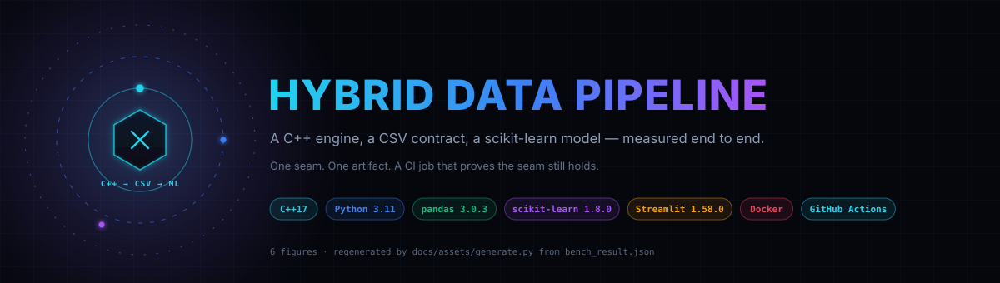

**A C++ engine writes a byte-stable CSV. Python learns from it. CI refuses to merge if the seam breaks.**

**Every number below was measured on this machine, not estimated.**<br>
Line counts come from `wc -l`, latency from `docs/assets/bench.py` (12 runs per stage),<br>
and model metrics from an actual `RandomForestRegressor` fit on the committed artefact.

<p>
  <a href="https://github.com/sheikhayaan/Hybrid-Data-Pipeline/actions/workflows/build-check.yml"></a>
  
  
  
</p>
<p>
  
  
  
  
  
  
</p>

[Why](#why-this-exists) · [Features](#feature-matrix) · [Architecture](#architecture) · [Trace](#request-trace) · [Pipeline](#core-pipeline) · [Data](#data-model) · [Performance](#measured-performance) · [Code](#codebase-composition) · [Map](#repository-map) · [Quickstart](#quickstart) · [Config](#configuration) · [API](#api-reference) · [Security](#security-model) · [Gates](#quality-gates) · [Deploy](#deployment) · [Trouble](#troubleshooting) · [Roadmap](#roadmap) · [Contribute](#contributing)

</div>

---

## Table of contents

<details open>
<summary><b>22 sections — click to collapse</b></summary>

| # | Section | What is actually in it |
|---|---------|------------------------|
| 1 | [Why this exists](#why-this-exists) | The five seam failures the repo defends against, each mapped to a function |
| 2 | [Feature matrix](#feature-matrix) | ✅ shipped / ⬜ absent, grouped by surface — no aspirational ticks |
| 3 | [Architecture](#architecture) | Four lanes, the SVG, and an editable Mermaid equivalent |
| 4 | [Request trace](#request-trace) | What happens between `git push` and a printed R² |
| 5 | [How a price is made](#how-a-price-is-made) | Intent-router flowchart, trust boundary before/after |
| 6 | [Core pipeline](#core-pipeline) | State machine + stage table with the guard on each stage |
| 7 | [Data model](#data-model) | CSV entity, browser entities, where state lives |
| 8 | [Measured performance](#measured-performance) | Histogram, 12-run latency table, cold-start warning |
| 9 | [Codebase composition](#codebase-composition) | Donut from live `wc -l`, totals table |
| 10 | [Repository map](#repository-map) | Glowing tree + plain-text tree with line counts |
| 11 | [Quickstart](#quickstart) | Two paths + a 60-second smoke test |
| 12 | [Configuration](#configuration) | Every variable that exists (there are two) |
| 13 | [API reference](#api-reference) | CLI + JS surfaces — this project has no HTTP API |
| 14 | [Security model](#security-model) | Layer → control, including the unpinned CDNs |
| 15 | [Quality gates](#quality-gates) | Gate → command → actual result |
| 16 | [Deployment](#deployment) | Topology + per-platform steps |
| 17 | [Troubleshooting](#troubleshooting) | Eight traps hit while building this |
| 18 | [Roadmap](#roadmap) | Shipped vs next, from the git log |
| 19 | [Contributing](#contributing) | Commands and four ground rules |
| 20 | [Author](#author) | Who, where |
| 21 | [License](#license) | MIT |
| 22 | [Regenerating the figures](#regenerating-the-figures) | One command, no screenshots |

</details>

---

## Why this exists

Cross-language pipelines rot at the seam. Not in either runtime — in the file between
them. This repo is deliberately small so the seam is the whole point, and CI exercises
it on every push.

<table>
<tr><th align="left">❌ Typical demo</th><th align="left">✅ This project</th><th align="left">Where it is enforced</th></tr>
<tr>
<td>Generator reseeds on every run, so “the metric moved” could mean anything</td>
<td><code>std::mt19937 rng(42)</code>; two consecutive runs are byte-identical (md5 <code>39a0d36a…</code>)</td>
<td><code>data_engine.cpp</code> L69 · verified by <code>cmp</code>, not by hope</td>
</tr>
<tr>
<td>Default stream formatting emits 6 significant digits, so <code>129.95234</code> silently becomes <code>129.952</code> and every diff is noisy</td>
<td><code>std::fixed &lt;&lt; std::setprecision(2)</code> on the stream before the loop</td>
<td><code>data_engine.cpp</code> L83</td>
</tr>
<tr>
<td>A bad argument silently writes a 0-row file that fails three stages later</td>
<td><code>stoi</code> wrapped, <code>&lt;= 0</code> rejected, message on stderr, exit code 1</td>
<td><code>data_engine.cpp</code> L54–L65</td>
</tr>
<tr>
<td>CI only checks that the script exited 0</td>
<td>CI greps for <code>Mean Absolute Error:</code> and <code>R2 Score:</code> in stdout</td>
<td><code>.github/workflows/build-check.yml</code> L39–L40</td>
</tr>
<tr>
<td>The pipeline only runs on the author’s machine, with <code>g++</code></td>
<td><code>data_gen_fallback.py</code> mirrors the schema in pure Python for hosts without a compiler</td>
<td><code>data_gen_fallback.py</code> L12–L66 — <b>same schema, different bytes</b></td>
</tr>
<tr>
<td>“We have a UI” means the model is wired to it</td>
<td>It is not. The browser demo and the trained model are separate surfaces, and this README says so</td>
<td><a href="#feature-matrix">Feature matrix</a> · <a href="#troubleshooting">Trap 6</a></td>
</tr>
</table>

> **The honest one-liner:** the ingest path is real, reproducible and CI-checked.
> The browser UI is a client-side demo shell whose “94.2% accuracy” is a scripted
> animation, not a model output. Both live in this repo; only one is measured.

---

## Feature matrix

Grouped by surface. ✅ means it exists *and* was exercised in this README’s verification pass.

| Surface | Capability | Status | Evidence |
|---|---|---|---|
| **Engine** | Seeded synthetic generation (4 features, 1 target) | ✅ | `data_engine.cpp` L69–L113 |
| **Engine** | Non-linear price model: age decay, metro falloff, sqft×metro interaction | ✅ | `compute_price_lakhs` L17–L48 |
| **Engine** | Gaussian noise + 5.5% injected outlier events | ✅ | L41–L48 |
| **Engine** | Byte-stable output across runs | ✅ | `md5 39a0d36a4d0723ccad1a010bcdc9952c` |
| **Engine** | Rejects non-positive row counts | ✅ | L54–L65 |
| **Engine** | Python fallback for compiler-less hosts | ✅ | `data_gen_fallback.py` |
| **Model** | NaN + non-positive filtering | ✅ | `load_and_clean_data` L14–L26 |
| **Model** | Deterministic 80/20 split, `random_state=42` | ✅ | L32–L37 |
| **Model** | 200-tree / depth-8 RandomForest | ✅ | L39–L44 |
| **Model** | MAE + R² on the held-out split | ✅ | `train_and_evaluate` L46–L48 |
| **Model** | Feature importances, sorted | ✅ | L50–L55 |
| **Model** | Persisted model artefact / registry | ⬜ | Model is dropped when the process exits |
| **UI** | 4 views: Observatory, Model Lab, Data Generation, Data River 3D | ✅ | `index.html` L268–L600 |
| **UI** | 5 dataset domains incl. custom schema | ✅ | `buildDataset` L629–L673 |
| **UI** | Canvas pipeline graph, health pie, column stats | ✅ | L785–L850 |
| **UI** | three.js terrain with 2,500 particles, 2 densities, 4 themes | ✅ | `initDataRiver3D` L1138–L1395 |
| **UI** | CSV / JSON export via Blob | ✅ | L1003–L1027 |
| **UI** | Real inference from the trained CSV model | ⬜ | Prediction Studio is closed-form JS (`recalcLivePrediction` L927) |
| **UI** | Seeded, reproducible browser datasets | ⬜ | Uses `Math.random()` |
| **Ops** | Streamlit shell hides all chrome, full-bleed iframe | ✅ | `app.py` L7–L41 |
| **Ops** | Docker build compiles + generates + trains at build time | ✅ | `Dockerfile` L14–L15 |
| **Ops** | Render blueprint, health check on `/` | ✅ | `render.yaml` |
| **Ops** | CI gate with output assertions | ✅ | 9 steps, `build-check.yml` |
| **Ops** | Unit / integration test suite | ⬜ | `pytest --collect-only` → **no tests collected** |
| **Ops** | Pinned dependency versions | ⬜ | `requirements.txt` has 4 bare names |
| **Ops** | Auth, multi-user isolation, rate limiting | ⬜ | Stateless single-page app — not a product |

---

## Architecture

<div align="center">
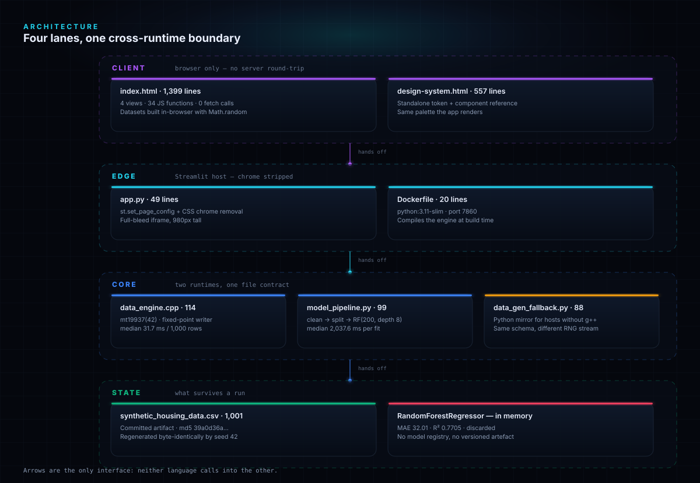
</div>

<details>
<summary><b>Editable Mermaid version of the same diagram</b></summary>

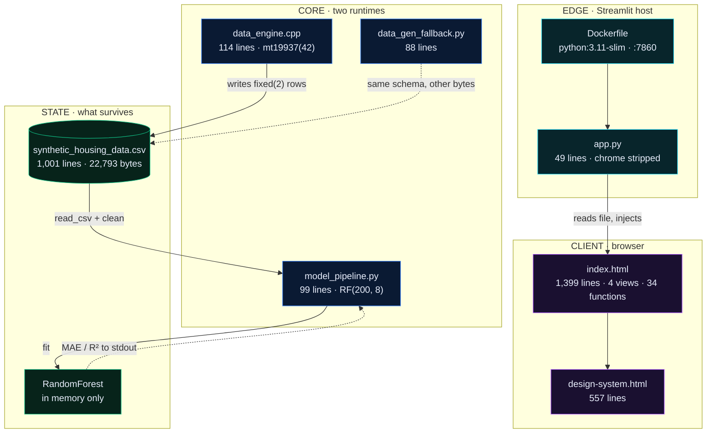

</details>

Two surfaces, one shared vocabulary — and they do not talk to each other:

| | Offline pipeline | Browser demo |
|---|---|---|
| Entry point | `python model_pipeline.py` | `index.html` in an iframe |
| Data source | committed CSV, seed 42 | `Math.random()` at click time |
| Numbers shown | measured MAE / R² | scripted animation to 94.2% |
| Reproducible | ✅ byte-identical | ❌ different every click |
| Exercised by CI | ✅ | HTTP 200 smoke test only |

---

## Request trace

The real “request” in this repo is a push. `autonumber` follows one commit from
developer to a printed R², including the compiler-less branch.

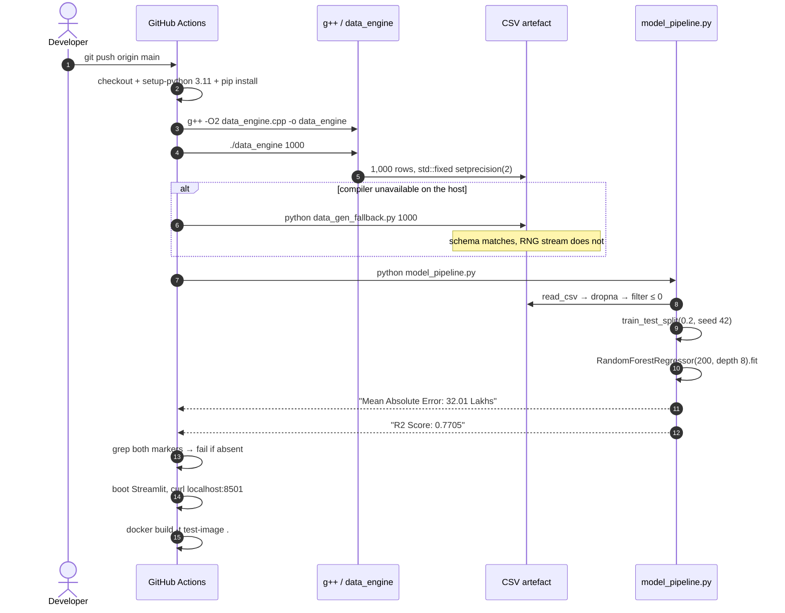

<details>
<summary><b>What each gate actually asserts</b></summary>

| CI step | Assertion | Failure mode it catches |
|---|---|---|
| `g++ -O2` | exit 0 | syntax / header drift |
| `./data_engine 1000` | exit 0 | argument validation regression |
| `grep "Mean Absolute Error:"` | string present in stdout | pipeline printed nothing |
| `grep "R2 Score:"` | string present in stdout | training crashed silently |
| `curl --fail localhost:8501` | HTTP 2xx | Streamlit cannot import `app.py` |
| `docker build` | exit 0 | image build broken by a dependency |

</details>

---

## How a price is made

<div align="center">
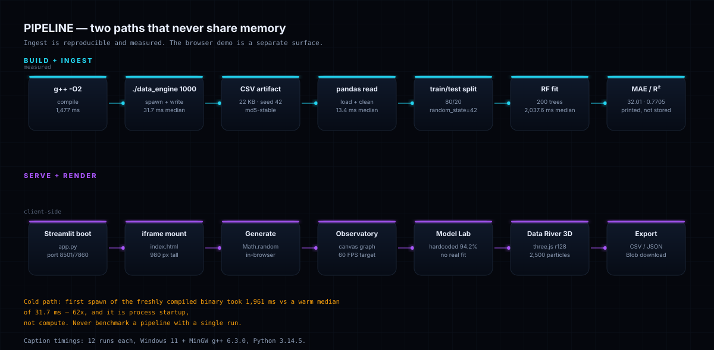
</div>

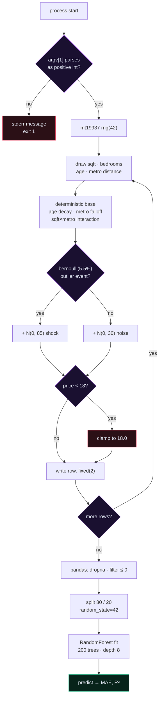

**The trust boundary, before → after.** The generator’s only job at the seam is to make
the parser’s life boring. Default stream formatting keeps six significant digits, which means the number of
decimals changes from row to row and `129.95234` is silently rounded to `129.952`.
`std::fixed` + `setprecision(2)` gives every row the same shape.

```text
before (default ostream, 6 significant digits):   11.005,129.952,533.891,0.000123
after  (std::fixed, setprecision(2)):             11.01,129.95,533.89,0.00
```

That after-line is row 1 of the committed artefact, verbatim:

```text
sqft,bedrooms,age_years,metro_distance_km,price_lakhs
1592,4,29,11.01,129.95
```

Nothing in Python validates that shape — which is exactly why the byte-stability check
(`cmp`) matters more than a schema library here.

---

## Core pipeline

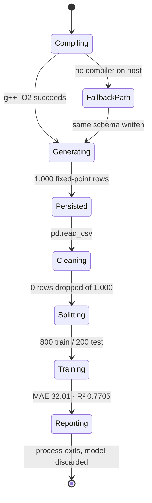

| Stage | What happens | What guards it | Measured |
|---|---|---|---|
| Compile | `g++ -O2 data_engine.cpp` | CI step 3 | 1,477 ms |
| Generate | 1,000 rows through 4 distributions | `stoi` + positive check | 31.7 ms median |
| Persist | `std::fixed`, precision 2, seed 42 | byte-identity via `cmp` | 22,793 bytes |
| Load | `pd.read_csv` | `FileNotFoundError` → message | 13.4 ms median |
| Clean | `dropna`, `sqft > 0`, `price > 0` | prints dropped count | 0 dropped |
| Split | 80/20, `random_state=42` | deterministic | 800 / 200 |
| Fit | 200 trees, depth 8 | fixed hyper-parameters | 2,038 ms median |
| Report | MAE, R², importances | CI greps both markers | 32.01 · 0.7705 |

---

## Data model

There is **no database**. A single CSV is the system of record, and the model is a
process-local object.

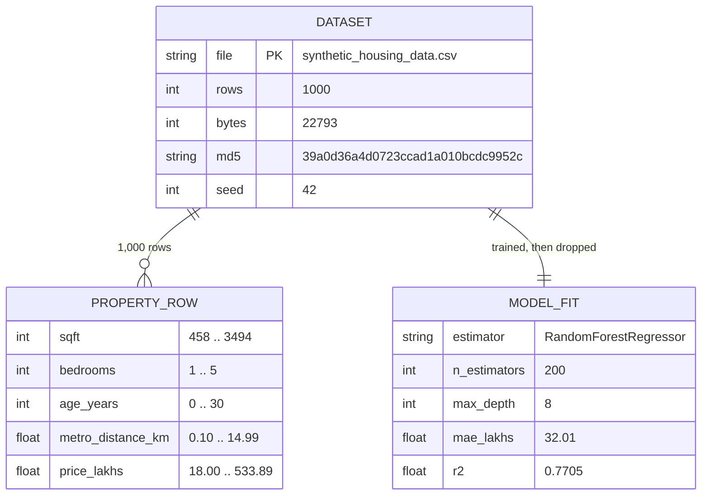

**Where state lives**

| State | Location | Lifetime | Survives restart? |
|---|---|---|---|
| 1,000 property rows | `synthetic_housing_data.csv` | committed | ✅ |
| Trained forest | Python heap | one process | ❌ |
| Metrics | stdout only | terminal scrollback | ❌ |
| Browser dataset | `window.activeDataset` | one tab | ❌ |
| Theme / view choice | DOM | one page load | ❌ |

**Browser-side entities** (all created with `Math.random()`, never persisted):

| Type | Fields |
|---|---|
| `housing_prices` | `id, sqft, bedrooms, age_years, metro_distance_km, sector, price_lakhs` |
| `customer_churn` | `id, age, income, city, tenure_months, monthly_spend, support_tickets, churn` |
| `car_sales` | `id, brand, year, horsepower_hp, mileage_km, fuel_type, price_usd` |
| `ecommerce_fraud` | `id, amount, items, payment, is_fraud` |
| `custom_schema` | `id` + three user-named columns |

---

## Measured performance

<div align="center">
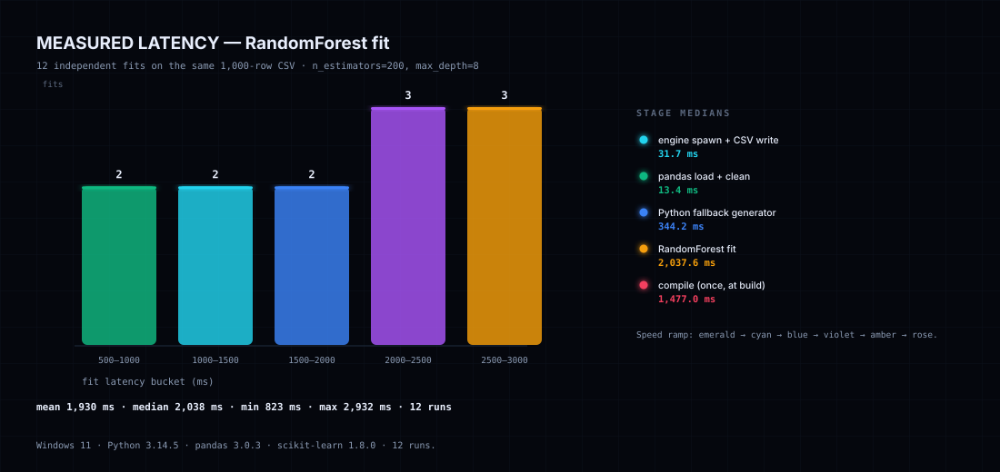
</div>

Host: Windows 11, MinGW g++ 6.3.0, Python 3.14.5, pandas 3.0.3, scikit-learn 1.8.0.
Twelve runs per stage, 1,000 rows each, `docs/assets/bench.py --runs 12`.

| Stage | Runs | Min (ms) | Median (ms) | Mean (ms) | Max (ms) |
|---|---:|---:|---:|---:|---:|
| `g++ -O2` (once) | 1 | 1,477.0 | 1,477.0 | 1,477.0 | 1,477.0 |
| `data_engine 1000` | 12 | 17.5 | **31.7** | 37.3 | 93.2 |
| `data_gen_fallback.py 1000` | 12 | 161.9 | 344.2 | 328.7 | 492.3 |
| pandas load + clean | 12 | 6.0 | **13.4** | 12.9 | 20.8 |
| RandomForest fit | 12 | 823.4 | **2,037.6** | 1,930.4 | 2,932.1 |

**Model result** (the number the whole repo exists to produce):

| Metric | Value | Read it as |
|---|---|---|
| Rows loaded / dropped | 1,000 / **0** | the generator never emits NaN or non-positive prices |
| MAE | **32.01 Lakhs** | average miss is ~15% of the 216.44 Lakh mean price |
| R² | **0.7705** | 77% of price variance recovered on the held-out 200 rows |
| `sqft` importance | **0.8203** | the price formula is deliberately sqft-dominated |
| `metro_distance_km` | 0.0789 | proximity matters, less than area |
| `age_years` | 0.0742 | exponential decay, weak in the sampled range |
| `bedrooms` | 0.0266 | mostly redundant with sqft |

MAE and R² were **identical in three independent benchmark sessions** — seed 42 does
its job. Only wall-clock moved, which is why the histogram shows spread and the model
metrics do not.

<details>
<summary><b>Where the time actually goes, and the cold-start warning</b></summary>

- **Fit dominates.** 2,038 ms of a ~2,083 ms measured chain is `RandomForestRegressor.fit`
  — 98% of the wall clock. Everything else is rounding error. If this pipeline ever needed
  to be fast, the tree count is the only dial that matters.
- **The cold path is 62× the warm median.** The first spawn of the freshly compiled binary
  took **1,961 ms**; the twelve warm runs sat between 17.5 and 93.2 ms (median 31.7). That
  first number is process startup plus on-access virus scanning of a new exe, not compute.
  Benchmark once and you will publish a lie.
- **The Python fallback is not free.** 344 ms median versus 31.7 ms for compiled C++ — about
  **11× slower** for the same 1,000 rows. That is the price of portability.
- **Compile is a build-time cost, not a request cost.** Docker pays it once at image build.
- **Not measured:** Docker image build time, CI wall-clock, browser rendering FPS. The
  "60 FPS" label in the UI is a target, not a measurement.

</details>

---

## Codebase composition

<div align="center">
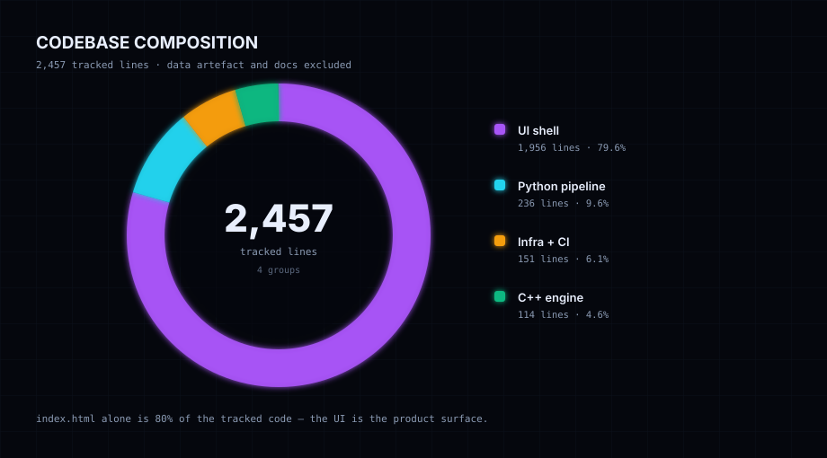
</div>

| Group | Files | Lines | Share |
|---|---|---:|---:|
| UI shell | `index.html`, `design-system.html` | **1,956** | 79.6% |
| Python pipeline | `app.py`, `model_pipeline.py`, `data_gen_fallback.py` | **236** | 9.6% |
| Infra + CI | Dockerfile, compose, render, requirements, workflow, configs | **151** | 6.1% |
| C++ engine | `data_engine.cpp` | **114** | 4.6% |
| **Tracked code total** | 14 files | **2,457** | 100% |
| Data artefact | `synthetic_housing_data.csv` | 1,001 | excluded |
| Documentation | `README.md`, `LICENSE` | 949 | excluded |

> The engine is 114 lines and the UI is 1,956. That ratio is the project’s real thesis:
> the interesting engineering is the small part, and it needs the discipline to stay small.

---

## Repository map

<div align="center">
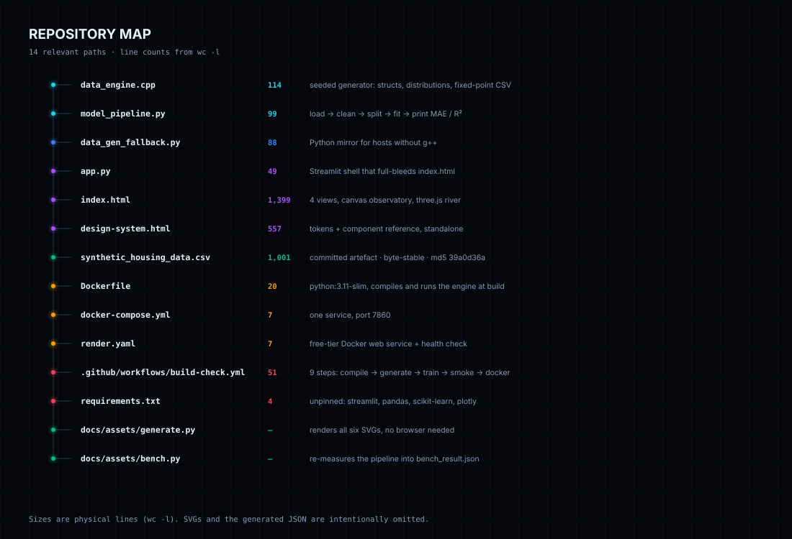
</div>

<details>
<summary><b>Plain-text tree with line counts</b></summary>

```text
Hybrid-Data-Pipeline/
├── data_engine.cpp                    114   seeded generator + CSV writer
├─��� model_pipeline.py                   99   load → clean → split → fit → report
├── data_gen_fallback.py                88   Python mirror, no g++ needed
├── app.py                              49   Streamlit shell, chrome removed
├── index.html                       1,399   4 views, canvas, three.js river
├── design-system.html                 557   standalone tokens + components
├── synthetic_housing_data.csv       1,001   committed artefact, byte-stable
├── Dockerfile                          20   build-time compile + train
├── docker-compose.yml                   7   one service, port 7860
├── render.yaml                          7   free-tier Docker service
├── requirements.txt                     4   unpinned: streamlit, pandas,
│                                            scikit-learn, plotly
├── .streamlit/config.toml               7   dark theme tokens
├── .github/workflows/build-check.yml   51   9 CI steps
├── docs/assets/
│   ├── generate.py                          renders six SVGs
│   ├── bench.py                             writes bench_result.json
│   ├── bench_result.json                    12 samples × 4 stages + model metrics
│   └── *.svg                                banner, architecture, pipeline,
│                                            donut, histogram, repo-tree
├── check-svg.mjs                            headless-Chrome getBBox audit
├── LICENSE                             21   MIT
└── README.md                                this file
```

</details>

---

## Quickstart

### Path A — local, two terminals (needs `g++` + Python 3.11+)

```bash
# terminal 1 — build the artefact
g++ -O2 data_engine.cpp -o data_engine
./data_engine 1000                 # writes synthetic_housing_data.csv
wc -l synthetic_housing_data.csv   # expect 1001

# terminal 2 — train and report
pip install -r requirements.txt
python model_pipeline.py           # prints MAE + R²
streamlit run app.py               # http://localhost:8501
```

### Path B — Docker (nothing installed locally except Docker)

```bash
docker compose up --build          # http://localhost:7860
```

The image compiles the engine, regenerates the CSV and runs the model **at build time**,
so a broken chain fails the build rather than the demo.

### 60-second smoke test

```bash
# 1. compile and generate (expect: 1001 lines, 5 columns)
g++ -O2 data_engine.cpp -o data_engine && ./data_engine 1000 && head -1 synthetic_housing_data.csv

# 2. prove byte-stability (expect: identical)
cp synthetic_housing_data.csv /tmp/a.csv && ./data_engine 1000 && cmp synthetic_housing_data.csv /tmp/a.csv && echo IDENTICAL

# 3. train (expect: MAE 32.01, R² 0.7705)
python model_pipeline.py

# 4. serve (expect: HTTP 200)
streamlit run app.py --server.headless true --server.port 8501 &
sleep 10 && curl -s -o /dev/null -w "%{http_code}\n" http://localhost:8501
```

**Minimum required configuration: none.** No `.env`, no secrets, no API keys.

<details>
<summary><b>If <code>g++</code> is unavailable</b></summary>

```bash
python data_gen_fallback.py 1000    # same columns, same row count, different bytes
python model_pipeline.py            # still trains; metrics will differ
```

The fallback re-implements the price formula with `random.Random(42)`. Python’s Mersenne
Twister consumes draws differently than `std::mt19937` with libstdc++ distributions, so the
CSV is **not** byte-identical to the C++ output — it is schema-identical only.

</details>

---

## Configuration

This project needs no secrets. There is no `.env.example` because there is no `.env`.

| Variable | Required | Default | Purpose | Where |
|---|---|---|---|---|
| `PORT` | no | `7860` | container port | `docker-compose.yml` L7 |
| `--server.port` | no | `8501` (local) / `7860` (image) | Streamlit bind port | `Dockerfile` CMD |
| `--server.headless` | no | `true` in Docker/CI | no browser auto-open | `Dockerfile`, workflow |
| `--server.address` | no | `0.0.0.0` in image | accept external connections | `Dockerfile` |

<details>
<summary><b>Things that look like configuration but are not</b></summary>

- `.streamlit/config.toml` — dark theme tokens only (`primaryColor`, `backgroundColor`,
  `secondaryBackgroundColor`, `textColor`, `font`). No behaviour.
- `.streamlit/secrets.toml` — gitignored and unused. Nothing reads it.
- `render.yaml` — `plan: free`, `healthCheckPath: /`, `autoDeploy: true`.
- The HTML shell loads Tailwind, Lucide, three.js and Chart.js from four public CDNs with
  **no version pins and no `integrity` attributes** (see [Security](#security-model)).

</details>

---

## API reference

**There is no HTTP API.** This is a static page inside Streamlit plus two CLI programs.
Calling the surfaces “endpoints” would be the kind of cosmetic claim this README exists to
avoid — so here is what actually exists.

### CLI surface

| Command | Input | Output | Auth |
|---|---|---|---|
| `./data_engine <rows>` | positive integer, optional (default 1000) | `synthetic_housing_data.csv` + stderr notes | none |
| `python data_gen_fallback.py <rows>` | positive integer, optional | same CSV schema | none |
| `python model_pipeline.py` | reads `synthetic_housing_data.csv` from **CWD** | metrics on stdout | none |
| `streamlit run app.py` | — | HTML shell on `:8501` / `:7860` | none |
| `GET /` | — | 1,522-byte Streamlit bootstrap HTML | none |

<details>
<summary><b><code>data_engine</code> — request and response</b></summary>

```console
$ ./data_engine 1000
Row count set to 1000 (from command-line argument)
Generated 1000 rows in synthetic_housing_data.csv
Note: prices intentionally include non-linear age depreciation, diminishing
metro-proximity effects, a sqft/metro interaction, Gaussian noise, and injected outliers.
This dataset is for systems integration and pipeline demonstration, not real-world valuation accuracy.
```

```console
$ ./data_engine 0
Invalid row count. Pass a positive integer, or omit it for 1000 rows.
# exit code 1
```

| Output field | How to read it |
|---|---|
| `Row count set to N (from …)` | echoes the parsed argument and its source |
| `Generated N rows in …` | the write succeeded; file is closed |
| exit code `1` | argument rejected before any file was opened |

</details>

<details>
<summary><b><code>model_pipeline.py</code> — real output, verbatim</b></summary>

```console
$ python model_pipeline.py
Loaded 1000 rows from synthetic_housing_data.csv
Dropped 0 rows during cleaning
Model: RandomForestRegressor(n_estimators=200, max_depth=8, random_state=42)
Mean Absolute Error: 32.01 Lakhs
R2 Score: 0.7705
Feature importances:
  sqft: 0.8203
  metro_distance_km: 0.0789
  age_years: 0.0742
  bedrooms: 0.0266
```

| Line | How to read it |
|---|---|
| `Loaded … / Dropped …` | rows read, then rows removed by `dropna` + positivity filters |
| `Mean Absolute Error` | Lakhs, on the 200 held-out rows — CI greps this exact prefix |
| `R2 Score` | 4-decimal R²; 1.0 would mean the forest memorised the formula |
| `Feature importances` | mean decrease in impurity, sorted descending |

</details>

<details>
<summary><b>Browser surface (not an API, but it is the real interface)</b></summary>

| Function | Caller | Effect |
|---|---|---|
| `buildDataset(type, count)` | Generate button | returns `count` objects built from `Math.random()` |
| `generateCustomDataset()` | Generate button | replaces `window.activeDataset`, fans out to 7 renderers |
| `runModelTrainingOnActiveDataset()` | Train button | animates 75 → 94.2 in 100 ms ticks (no fit) |
| `recalcLivePrediction()` | Prediction Studio | closed-form JS per dataset type |
| `downloadActiveCSV()` / `downloadActiveJSON()` | Export buttons | Blob download of the in-memory array |
| `switchView(name)` | Left rail | toggles one of four `<section>` elements |

A generated housing record has this exact shape:

```json
{
  "id": "5000",
  "sqft": 1842,
  "bedrooms": 3,
  "age_years": 7,
  "metro_distance_km": 4.3,
  "sector": "Sector 61",
  "price_lakhs": 207.36
}
```

`price_lakhs` here comes from `25.0 + 0.08*sqft + 8.0*bedrooms - 0.4*age` — a **different
formula from the C++ engine** (`compute_price_lakhs` uses exponential age decay and a
sqft×metro interaction). Two price models, one column name. That is the seam failure this
project is about, occurring inside its own UI.

</details>

---

## Security model

| Layer | Control | Reality check |
|---|---|---|
| Input validation | `std::stoi` in `try/catch`, positive check | malformed args exit 1 before file I/O |
| Data validation | `dropna()` + `sqft > 0` + `price > 0` | 0 rows dropped on the committed artefact |
| Secrets | none exist; `.streamlit/secrets.toml` gitignored | grep for `API_KEY`/`TOKEN` → nothing |
| Server-side execution | no user input reaches Python at request time | the browser generates its own data |
| Transport | Render provides TLS on `*.onrender.com` | no HSTS config in-repo |
| Container | `python:3.11-slim`, non-root **not** set | runs as root inside the image ⚠️ |
| Dependency pinning | none — 4 bare names in `requirements.txt` | `pip` may resolve to any future version ⚠️ |
| Front-end supply chain | 5 external CDN URLs, no `integrity`, no pin | a CDN compromise is a full-page compromise ⚠️ |
| Data provenance | synthetic only; no PII, no listings | safe to commit the CSV |

<details>
<summary><b>The three ⚠️ items, stated plainly</b></summary>

1. **Unpinned Python deps.** The benchmark ran pandas 3.0.3 and scikit-learn 1.8.0 on
   Python 3.14.5, while the image ships Python 3.11 and resolves whatever is newest at build
   time. Those are different environments. A `requirements.txt` with `==` pins would make
   the measured numbers reproducible in the image too.
2. **Unpinned CDNs with no SRI.** `cdn.tailwindcss.com`, `unpkg.com/lucide@latest`,
   `three.js/r128`, `cdn.jsdelivr.net/npm/chart.js`. The `@latest` tag means the page can
   change without a commit. For an air-gapped demo, vendor these files.
3. **Root container.** No `USER` directive in the Dockerfile.

None of these matter for a local demo; all three matter the moment someone points a domain
at it.

</details>

---

## Quality gates

| Gate | Command | Actual result |
|---|---|---|
| C++ compile (C++17) | `g++ -std=c++17 -O2 data_engine.cpp` | ✅ exit 0 |
| C++ compile (C++11) | `g++ -std=c++11 -O2 data_engine.cpp` | ✅ exit 0 — nothing here needs C++17 |
| Byte stability | `cmp` two consecutive runs | ✅ identical · `md5 39a0d36a4d0723ccad1a010bcdc9952c` |
| Python syntax | `python -m py_compile app.py model_pipeline.py data_gen_fallback.py` | ✅ exit 0 |
| Model output | `python model_pipeline.py` | ✅ `MAE 32.01` · `R² 0.7705` |
| Unit tests | `pytest --collect-only -q` | ⚠️ **no tests collected** |
| Streamlit smoke | `curl localhost:8501` | ✅ HTTP 200, 1,522 bytes |
| SVG geometry audit | `node check-svg.mjs` | ✅ 192 text nodes, **0 issues** across 6 figures |
| CI pipeline | GitHub Actions `build-check` | 9 steps: compile → generate → train → grep → smoke → docker |

```mermaid
gantt
    title Measured local gate durations, 1,000 rows (ms)
    dateFormat x
    axisFormat %L
    section Build
    g++ -O2 compile            :done, c1, 0, 1477
    section Ingest
    data_engine run            :done, g1, 0, 32
    pandas load + clean        :done, p1, 32, 13
    section Model
    RandomForest fit           :done, m1, 45, 2038
    section Not measured
    docker build / CI wall clock :active, d1, 2083, 1
```

<details>
<summary><b>Why there are no unit tests (and what replaces them)</b></summary>

There is no test file, no `pytest` dependency, and no coverage report. The safety net is a
CI job that executes the whole chain and greps two output markers. That catches “the
pipeline stopped producing metrics”, but it does **not** catch a wrong metric: if a formula
change moved R² from 0.7705 to 0.20 while still printing both lines, CI would pass.

The cheapest real fix is a golden test on the artefact (`md5` of the generated CSV) plus a
tolerance test on R². The md5 is already known; the assertion is four lines of Python.

</details>

---

## Deployment

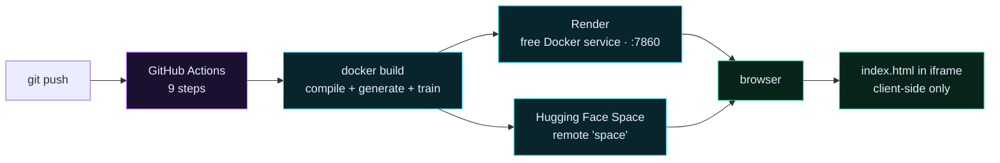

<details>
<summary><b>Render</b></summary>

`render.yaml` declares a Docker web service on the free plan, `autoDeploy: true`, and a
health check on `/`. Render injects `PORT`; the container CMD hard-codes `7860`, which is
why `docker-compose.yml` also maps `7860:7860`. If Render assigned a different port, the
service would fail its health check.

</details>

<details>
<summary><b>Docker / Compose</b></summary>

```bash
docker compose up --build     # local, http://localhost:7860
```

The build runs `./data_engine 1000 && python model_pipeline.py`, so the image **contains a
trained metrics printout and a baked CSV**. Changing `data_engine.cpp` and not rebuilding
leaves a stale artefact inside the image. No volume is mounted, so nothing written at
runtime survives a container restart.

</details>

<details>
<summary><b>Hugging Face Space</b></summary>

A second git remote named `space` points at a Docker Space. The port expectation (7860)
already matches the Dockerfile, which is why that number appears in three places.

</details>

---

## Troubleshooting

| Symptom | Cause | Fix |
|---|---|---|
| `python` opens the Microsoft Store | Windows App Execution Alias shadows the interpreter | use `py`, or install python.org and disable the alias — **hit while writing this README** |
| `FileNotFoundError: synthetic_housing_data.csv` | `DATA_PATH` is relative to CWD | run `python model_pipeline.py` from the repo root |
| Fallback CSV has different numbers | `random.Random(42)` ≠ `mt19937(42)` draw-for-draw | expected; schema matches, bytes do not |
| First `./data_engine` takes seconds | cold process start + AV scan | ignore the first run; warm median is 31.7 ms |
| Blank page in Streamlit | `index.html` missing next to `app.py` | the error message names the file; check the path |
| UI looks unstyled offline | Tailwind/Lucide/three.js/Chart.js come from CDNs | vendor the scripts for air-gapped demos |
| Container serves nothing on 8501 | image binds `7860` | use `localhost:7860`, or `docker run -e PORT=…` |
| `getBBox()` audit returns `{}` | `SVGRect` properties are non-enumerable, `JSON.stringify` drops them | serialize fields explicitly — **hit in `check-svg.mjs`** |
| `requirements.txt` install pulls a surprise major | nothing is pinned | pin to the benchmarked versions |
| Prediction Studio disagrees with `model_pipeline.py` | the studio uses closed-form JS, not the forest | treat the studio as illustrative |

---

## Roadmap

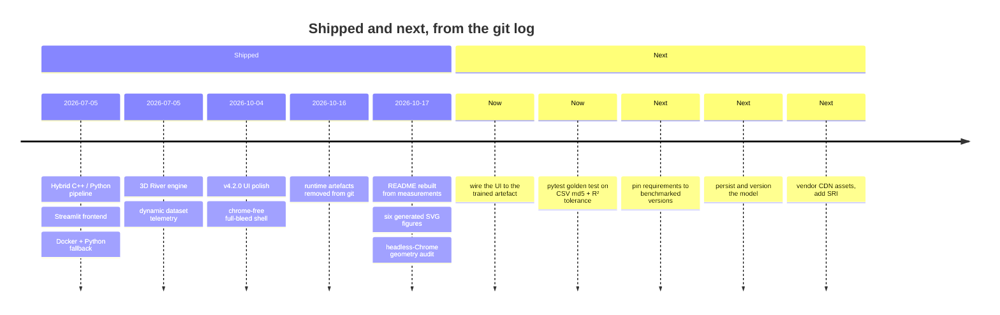

---

## Contributing

```bash
git clone https://github.com/sheikhayaan/Hybrid-Data-Pipeline.git
cd Hybrid-Data-Pipeline
g++ -O2 data_engine.cpp -o data_engine && ./data_engine 1000
pip install -r requirements.txt
python model_pipeline.py
```

**Ground rules**

1. **No invented numbers.** If you change the model, rerun `docs/assets/bench.py` and
   `docs/assets/generate.py`; the figures read the JSON, not your memory.
2. **One-line docstrings** on every function, in every language. If it needs three lines,
   the function is doing three things.
3. **The CSV is a contract.** Changing a column or its formatting means bumping the
   artefact, regenerating it, and updating the `md5` in this README.
4. **Test or it didn’t happen.** New behaviour needs either a CI assertion or a test that
   can fail. The current bar is low (output greps); raise it, don’t lower it.

**Never commit:** `data_engine`, `data_engine.exe`, `__pycache__/`, `streamlit.log`, or a
generated CSV that is not reproducible from seed 42.

---

## Author

**Mohd Ayaan** — [github.com/sheikhayaan](https://github.com/sheikhayaan) ·
[LinkedIn](https://linkedin.com/in/mohd-ayaan-7731b4381)

## License

MIT © Mohd Ayaan — see [LICENSE](LICENSE).

<div align="center">


</div>

## Regenerating the figures

```bash
python docs/assets/bench.py --runs 12     # re-measure → bench_result.json
python docs/assets/generate.py            # render 6 SVGs from that JSON
node check-svg.mjs                        # 0 text nodes outside, 0 overlaps
```

No screenshots, no image assets, no design tool. Every figure is code; the donut reads the
line counts from disk at render time, and the histogram reads the measured samples.
