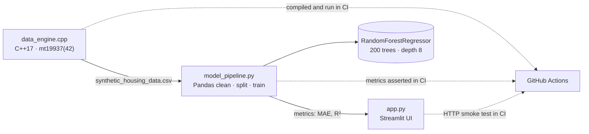

# Hybrid Data Pipeline

**A C++ data engine feeding a Python machine-learning workflow across a file boundary — and a CI job that proves the seam still works.**

A C++17 engine models and generates synthetic housing records with a seeded
`std::mt19937`, writes them to CSV, and hands that file to a Pandas + scikit-learn
layer that cleans, trains, and evaluates. Streamlit sits on top; Docker packages the
whole chain.

`C++17` `Python 3.11` `Pandas` `scikit-learn` `Streamlit` `Docker` · MIT

[](https://github.com/sheikhayaan/Hybrid-Data-Pipeline/actions/workflows/build-check.yml)

---

## Why this exists

Cross-language pipelines usually rot at the seam, where two runtimes quietly disagree
about the data between them: a column renamed, a unit changed, a float formatted
differently. This project is built so that the seam is the *only* interface, and so
that CI exercises it end to end on every push.

## Architecture



**The pipeline, stage by stage**

1. `data_engine.cpp` models a `Property` and generates rows with distributions over
   square footage, bedrooms, property age and metro distance, then prices them. Seeded,
   so the file is byte-stable.
2. `synthetic_housing_data.csv` is the boundary: a header and fixed-point numbers, no
   binary, no schema object shared between runtimes.
3. `model_pipeline.py` loads and cleans with Pandas, splits with `random_state=42`,
   trains `RandomForestRegressor(n_estimators=200, max_depth=8)` and reports mean
   absolute error and R².
4. `app.py` serves the result through Streamlit.

## Design decisions

1. **CSV instead of FFI, a socket, or a shared database.** The point of the exercise is
   the contract, and a file is the smallest contract that can be inspected with `head`,
   versioned in git, and replayed. Neither language calls into the other, so either half
   can be run, tested, or replaced alone.
2. **Seeded RNG (`std::mt19937 rng(42)`).** A generator that produces a different file
   each run turns every metric into a lottery. With a fixed seed, "R² went down" means
   the code changed.
3. **Fixed-point formatting in the writer** (`std::fixed`, `setprecision(2)`) so the
   Python parser never sees `1e+06` and the file stays diffable.
4. **CI asserts the *output*, not just the exit code.** The workflow compiles with
   `g++ -O2`, runs the engine for 1000 rows, greps the pipeline output for
   `Mean Absolute Error:` and `R2 Score:`, boots Streamlit headless and `curl`s it, then
   builds the Docker image. A pipeline that silently produces zero rows fails here.
5. **Bounded, self-describing inputs.** The engine rejects a non-positive row count with
   a message and a non-zero exit, instead of writing an empty file that would fail three
   stages later.

## Repository layout

```
data_engine.cpp              C++ generator: structs, distributions, CSV writer
model_pipeline.py            load → clean → split → train → evaluate (prints metrics)
app.py                       Streamlit front-end
design-system.html           standalone design reference for the UI shell
Dockerfile, docker-compose   container build; Render blueprint in render.yaml
.github/workflows            build-check: compile → generate → train → smoke → docker
```

## Quick start

**Local** (needs `g++` and Python 3.11):

```bash
g++ -O2 data_engine.cpp -o data_engine
./data_engine 1000                 # writes synthetic_housing_data.csv
pip install -r requirements.txt
python model_pipeline.py           # prints MAE and R²
streamlit run app.py               # http://localhost:8501
```

**Docker:**

```bash
docker compose up --build
```

If `g++` is unavailable, `data_gen_fallback.py` produces the same CSV shape in Python —
the analytics half stays runnable, which is the whole point of the file boundary.

## What the numbers mean

The reported MAE and R² describe how well the model recovers a *generated* price
function. They are a correctness signal for the pipeline, not a claim about Gurgaon
property prices.

## Limits

- **Synthetic data.** No real listings; the generator encodes the relationships the model
  then learns, so a high R² is expected rather than impressive.
- **The model is trained, reported, and dropped.** Nothing persists between runs — no
  model registry, no versioned artefact; `model_pipeline.py` is a report, not a deployer.
- **Single-file dataset.** At 1000 rows everything fits in memory; this is not a
  distributed pipeline and does not pretend to be.

## Author

**Mohd Ayaan** — [github.com/sheikhayaan](https://github.com/sheikhayaan) ·
[LinkedIn](https://linkedin.com/in/mohd-ayaan-7731b4381)

MIT licensed. See [LICENSE](LICENSE).
